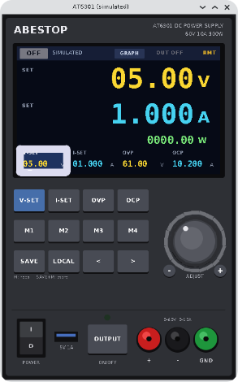

# AT6301 front panel

A program for macOS, Linux and Windows that controls an Abestop AT6301 bench power
supply (60 V, 10 A, 300 W) over its USB port. It is written in C using the
AMI tool kit, and the window is drawn to look like the front of the supply.

## Build and run

    make                     # needs ~/projects/amitk built (or set AMIDIR)
    ./at6301                 # finds the supply on USB
    ./at6301 -p /dev/cu.usbserial-1410    # macOS
    ./at6301 -p /dev/ttyUSB0              # Linux
    ./at6301 -p COM5                      # Windows
    ./at6301 --sim           # no hardware: simulated supply driving an 8 ohm load
    make sim                 # same as ./at6301 --sim

On Linux the link uses whichever graphics backend amitk was built with
(Wayland, X11 or the frame buffer; amitk records it in `lib/graph_backend`),
so build amitk first under the session you will run the panel in.

### Linux: the serial port

The supply is a CH340 USB serial adapter, which the kernel drives without any
extra install. It appears as `/dev/ttyUSB0` (or `ttyUSB1`... if other adapters
are present), owned by group `dialout`. Add yourself to that group once, then
log out and in again:

    sudo usermod -aG dialout $USER

Until then the panel shows "No permission for /dev/ttyUSB0" in its status line.

### Linux: application menu entries

    make install             # AT6301 and AT6301 (simulated) in the app menu
    make uninstall

The entries run the `at6301` program in this folder, so run `make install`
again if you move the folder.

### macOS: menu bar icon

    make install             # builds AT6301Bar.app, copies it to ~/Applications,
                             # adds it to Login Items and starts it
    make uninstall           # removes all of that

This puts a bolt icon in the menu bar. Its menu has these items:

- **Open AT6301** opens the panel, or brings it forward if it is already
  open.
- **Open AT6301 (simulated)** opens the panel with the simulated supply.
- **Close AT6301** closes the panel. The supply still goes back to local
  control.
- **Quit menu bar icon** removes the icon.

The launcher runs the `at6301` program in this folder, so run `make install`
again if you move the folder.

### Windows: building

The build is by MinGW gcc from an MSYS2 shell (MINGW64 or UCRT64), the same
toolchain that builds amitk; amitk's INSTALL file says how to set that up.
With amitk built, `make` here produces `at6301.exe`, which runs from the shell
or from Explorer. If amitk is not in `~/projects/amitk`, a checkout beside
this folder is used, or set AMIDIR.

### Windows: the serial port

Windows 10 and 11 fetch a driver for the supply's CH340 adapter the first time
it is plugged in, after which the supply is a COM port (COM3, COM5...; Device
Manager lists it under Ports as "USB-SERIAL CH340"). The program finds it by
itself, taking a CH340 first and any other USB serial adapter after that, and
never the machine's own COM ports. To pick a port by hand:

    ./at6301 -p COM5

Only one program can hold a COM port at a time. While a terminal program has
it, the panel shows "COM5 is in use by another program".

### Windows: Start menu entries

    make install             # AT6301 and AT6301 (simulated) in the Start menu
    make uninstall

The entries run `at6301.exe` in this folder, so run `make install` again if
you move the folder.

On macOS the supply shows up as `/dev/cu.usbserial-*`, or as
`/dev/cu.wchusbserial*` if you use the WCH driver. If neither appears, install
the WCH CH34x driver. On Linux it is `/dev/ttyUSB*`, and on Windows `COMn`.
The program looks for the supply every 2 s, so you can plug it in after
starting.

## Using it

| Control | Action |
|---|---|
| V-SET / I-SET / OVP / OCP, or a field on the screen | Choose the setting the knob changes |
| Knob: drag up/down, mouse wheel or two-finger trackpad scroll anywhere, or click its left/right half | Step the underlined digit |
| `-` / `+` buttons beside the knob | Step down/up; hold to repeat |
| `<` `>` | Move the underlined digit |
| OUTPUT | Switch the output on or off. The lamp shows the state |
| M1 to M4 | Recall a stored voltage and current. The output is not switched |
| SAVE, then M1 to M4 | Store the present voltage and current |
| LOCAL | Give control back to the supply's own front panel |

Keyboard shortcuts:

- `v` / `i` choose a setting; Tab moves to the next one.
- Type digits and `.`, then press Enter to set the value or Esc to cancel.
- Up/Down step the value; Left/Right move the digit; `+` / `-` also step.
- `o` switches the output.
- `g` switches the graph; `s` changes its span; `x` saves CSV; `c` clears
  the history.

Knob changes are sent after 150 ms with no further turning, so a fast spin
becomes one command. A `*` on a setting means the change has not been sent
yet. Presets are kept in `~/.at6301rc` (in the user profile folder on
Windows).

The display shows:

- Measured volts, amps and watts while the output is on. With the output off,
  the big readouts show the voltage and current settings, marked SET.
- CV / CC / OFF / PROT mode.
- The port in use.
- RMT or LOC.
- A red banner when OVP, OCP or over-temperature has tripped. Switching the
  output on again clears the trip.

### Graph

GRAPH in the display's status bar (or `g`) turns the big readouts into a strip
chart of measured volts (yellow, left scale), amps (cyan, right scale) and
watts (green, own scale shown at top left). The measurements are sampled every
200 ms whether or not the graph is shown, and the last 30 minutes are kept.

- Click a legend entry to hide or show that trace. The live values stay in the
  legend.
- SPAN cycles the time across the chart: 30 s, 1, 5, 10 or 30 minutes.
- CSV saves the whole history to `~/Desktop/AT6301_<date>_<time>.csv` (or to
  the home directory when there is no Desktop folder) with columns
  `time,seconds,volts,amps,watts`.
- Scales fit the data in view, rounded to 1, 2 or 5 steps. Gaps show where
  the supply was disconnected.

## Safety

- Connecting never switches the output on.
- Closing the window (or a SIGTERM, which Close AT6301 sends) sends `SYST:LOC`, which hands control back to the front
  panel. The output is left as it was.

## Protocol

The supply runs at 115200 8N1, and every line ends with CR LF. The commands
below come from the open-source Benchflow driver (the hardware matches the
OWON SPE6103):

| Command | Reply / meaning |
|---|---|
| `*IDN?` | `Abestop,AT6301,<serial>,FV:<fw>` |
| `MEAS:ALL:INFO?` | `V,A,W,OVP,OCP,OTP,mode`. Faults are `ON`/`OFF`; mode is 0 standby, 1 CV, 2 CC, 3 fault |
| `VOLT <v>` / `VOLT?` | Voltage setpoint, 10 mV steps |
| `CURR <a>` / `CURR?` | Current limit, 1 mA steps |
| `VOLT:LIM <v>` / `VOLT:LIM?` | OVP |
| `CURR:LIM <a>` / `CURR:LIM?` | OCP |
| `OUTP ON\|OFF` / `OUTP?` | Output |
| `SYST:REM` / `SYST:LOC` | Remote / local |

The program sends one command at a time. It polls measurements every 200 ms
and re-reads the settings every 2 s, so changes made on the real front panel
also show up. If 4 replies in a row are missed, it treats the supply as gone
and reconnects.

## Files

- `at6301.c`: the front panel (drawing, input, presets).
- `psu.c`, `psu.h`: the serial link, the command queue and the simulator.
- `menubar.m`, `menubar.plist`: the macOS menu bar launcher.
- `at6301.desktop`, `at6301-sim.desktop`: the Linux application menu entries.
- `startmenu.ps1`: the Windows Start menu entries.

## Caveats

- On Windows the link has been tried against the real supply for reading
  only (finding the port, identity, settings and measurements); setting
  values from Windows has not been exercised yet.
- Started with wrong options on Windows the program just exits: as a
  windowed program it has no console to print the usage line to.
- The panel layout is drawn from the product description, not from the real
  supply, so it is an approximation.
- I am not sure of the OVP and OCP upper limits (set here to 62 V and 10.5 A).
  The readback shows what the supply actually accepted.
